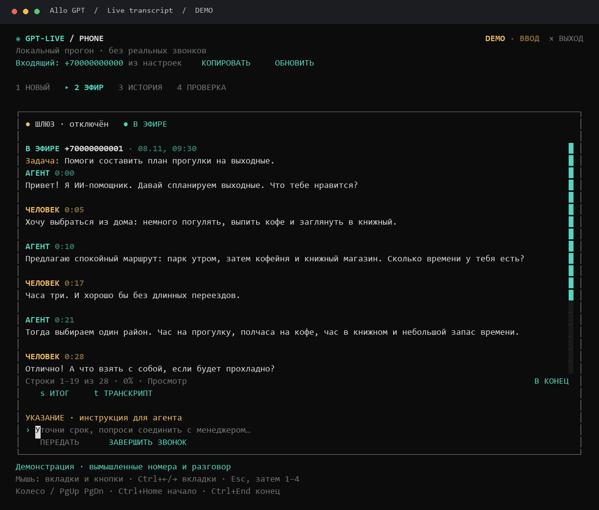
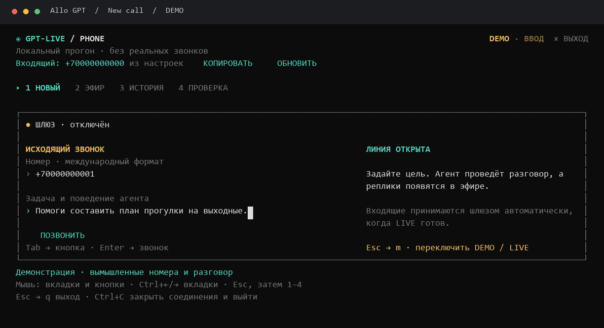
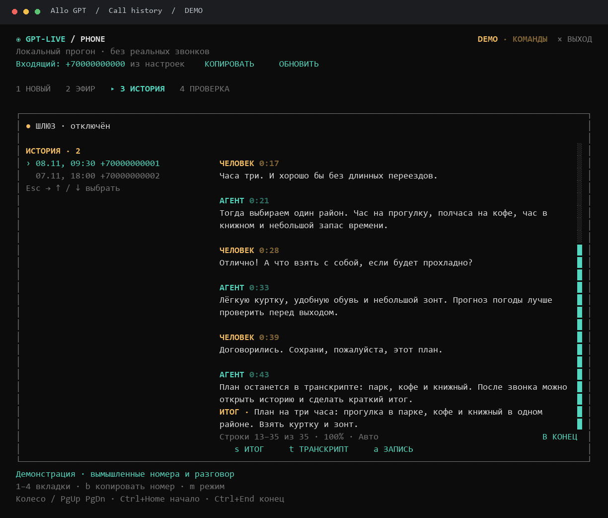
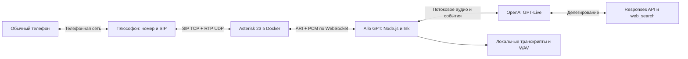

# Allo GPT

**Голосовой ИИ-помощник с обычным телефонным номером — прямо из терминала.**

Позвоните на номер Плюсофона, и ответит GPT-Live. Или задайте номер и цель разговора в консоли: агент сам позвонит, поговорит, при необходимости найдёт информацию в интернете и сохранит диалог по ролям.




> Скриншоты показывают настоящий интерфейс Ink на вымышленных демонстрационных данных. Номера `+70000000000`, `+70000000001` и `+70000000002` — заглушки: звонить на них не нужно.

## Что умеет

- Принимать входящие и вручную запускать исходящие звонки на российские номера.
- Разговаривать голосом через GPT-Live, прерывать ответ, когда собеседник начинает говорить.
- Передавать сложные вопросы в Responses API, использовать встроенный поиск в интернете.
- Принимать дополнительные указания владельца прямо во время разговора.
- Сохранять реплики человека и агента с временными отметками в JSON, TXT и Markdown.
- Записывать полный разговор в WAV и открывать его из истории.
- По отдельной команде делать краткий пересказ или отправлять транскрипт в Telegram.
- Показывать подключённый номер через API Плюсофона и копировать его в буфер обмена Windows.
- Управляться мышью и клавиатурой: вкладки, кнопки, прокрутка диалога, индикатор положения.

Это приложение для одного разговора за раз. Массового обзвона, автоматического перебора номеров и автодозвона здесь нет.

<details>
<summary>Ещё скриншоты: новый звонок и история</summary>





</details>

## Быстрый запуск без телефона и ключей

Нужен Node.js 22 или новее. Команды ниже рассчитаны на PowerShell в Windows; в других оболочках используйте `npm` вместо `npm.cmd` и обычное копирование файла.

```powershell
git clone https://github.com/HuHguZ/allo-gpt.git
cd allo-gpt
npm.cmd ci
Copy-Item .env.example .env
npm.cmd run demo
```

В DEMO исходящий звонок разыгрывается локально: OpenAI, Плюсофон и Telegram не вызываются. Можно проверить форму, транскрипт, историю и пересказ. Реальная аудиозапись в этом режиме не создаётся.

Проверка демо без интерактивного терминала:

```powershell
npm.cmd run demo -- --smoke
```

После заполнения `.env` можно запускать приложение двойным щелчком по **`start.bat`**. `start.cmd` делает то же самое. Батник устанавливает отсутствующие зависимости, собирает приложение, а в режиме LIVE генерирует конфигурацию и запускает Asterisk в Docker.

## Как устроен звонок



**Плюсофон** предоставляет номер и подключение к телефонной сети. **Asterisk** принимает SIP-звонок и преобразует телефонный звук в PCM 24 кГц для приложения. **Node.js** связывает телефонию с голосовой сессией OpenAI, управляет завершением и хранением разговора. **Ink + React** рисуют интерфейс терминала. Поиск выполняется через инструменты Responses API.

API-токен Плюсофона нужен только для получения своего номера в интерфейсе. Звук и сами звонки идут через SIP, а не через этот REST API.

## Что нужно для настоящих звонков

| Компонент | Для чего нужен |
| --- | --- |
| Node.js 22+ и npm | Приложение, сборка и терминальный интерфейс |
| Docker Desktop с Linux containers | Локальный Asterisk с ARI и `chan_websocket` |
| Активированный номер и SIP-аккаунт Плюсофона | Входящие и исходящие телефонные звонки |
| OpenAI API key с доступом к GPT-Live и Responses | Голос и выполнение запросов с инструментами |
| Положительный баланс у операторов | Телефония и API оплачиваются отдельно |
| Терминал с интерактивным вводом | Рекомендуется Windows Terminal |

Подписка ChatGPT не заменяет оплату OpenAI API. Доступность моделей, стран и услуг проверяйте по актуальным условиям провайдеров. Работа звонков также зависит от SIP/RTP-маршрутизации и NAT.

### 1. Подключите номер в Плюсофоне

1. Зарегистрируйтесь в [личном кабинете](https://lk.plusofon.ru/). Пройдите запрошенную оператором идентификацию и оформление договора, включая Госключ, если он предложен кабинетом.
2. В разделе **«Номера» → «Городские номера»** подключите номер. Дождитесь активации договора и номера. Отображение номера в списке само по себе не подтверждает, что все ограничения уже сняты.
3. Проверьте баланс, списание абонентской платы и возможность исходящих звонков. Стоимость подключения, абонентская плата и минуты зависят от выбранного номера и тарифа — смотрите кабинет и [сайт оператора](https://plusofon.ru/).
4. В **«SIP аккаунты»** создайте или выберите отдельный аккаунт для приложения. Скопируйте адрес SIP-сервера, логин и **настоящий пароль**. Маска пароля или текст `<redacted>` не подходят.
5. Настройте маршрут входящего вызова с номера на этот SIP-аккаунт. В зависимости от кабинета это делается в настройках номера или сценарии входящего звонка.
6. Для исходящих разрешите нужное направление и назначьте подключённый номер как АОН/Caller ID для SIP-аккаунта. Если в кабинете есть дополнительные ограничения или обязательные услуги, выполните требования оператора.

Перенесите данные в локальный `.env`:

| Переменная | Значение |
| --- | --- |
| `PLUSOFON_SIP_HOST` | Сервер из SIP-настроек, без `sip:`, порта и пути |
| `PLUSOFON_SIP_USERNAME` | SIP-логин, не номер договора и не email |
| `PLUSOFON_SIP_PASSWORD` | Полный SIP-пароль |
| `PLUSOFON_CALLER_NUMBER` | Ваш подключённый номер в формате `+7XXXXXXXXXX` |

Приложение генерирует PJSIP-конфигурацию с TCP-транспортом, авторизацией, outbound proxy и заголовком `P-Charge-Info` для исходящих вызовов. SIP-логин используется в поле `callerid` транка; публичный номер устанавливается отдельно в исходящем маршруте. Не заменяйте SIP-логин номером телефона во всех полях.

**Необязательно: получение номера через API.** Откройте раздел API в кабинете Плюсофона, создайте токен и сохраните его в `PLUSOFON_API_TOKEN`. Название раздела может отличаться в версиях кабинета. Приложение выполняет только `GET /api/v1/number`, сверяет список с `PLUSOFON_CALLER_NUMBER` и показывает источник «Плюсофон API». Заголовок `Client: 10553` — идентификатор API-клиента, он уже задан в коде; это не номер вашего договора.

Без токена в шапке показывается номер из `.env`. Ошибка обновления номера не заменяет его чужим номером и не меняет настройки маршрутизации.

### 2. Подготовьте OpenAI API и локальный пароль ARI

Создайте проектный API-ключ в [OpenAI Platform](https://platform.openai.com/api-keys), проверьте биллинг и доступ к моделям. В `.env.example` указаны модели, которые использует приложение:

```dotenv
OPENAI_LIVE_MODEL=gpt-live-1
OPENAI_BACKEND_MODEL=gpt-6-luna
OPENAI_VOICE=marin
OPENAI_WEB_SEARCH=true
```

Голос можно заменить через `OPENAI_VOICE`, например на `cedar`, если он доступен вашей модели. Названия голосов в приложении ChatGPT и API могут отличаться. Ключи не нужно вставлять в код или отправлять в issue.

Сгенерируйте отдельный пароль для **своего локального Asterisk**:

```powershell
node -e "console.log(require('node:crypto').randomBytes(24).toString('hex'))"
```

Вставьте результат в `ASTERISK_ARI_PASSWORD`. Этот пароль не связан ни с OpenAI, ни с SIP-паролем Плюсофона.

### 3. Заполните `.env`

Скопируйте [.env.example](.env.example), затем заполните пустые поля. Ниже только шаблон: замените все значения-заглушки, включая номер.

```dotenv
PHONE_MODE=live
OPENAI_API_KEY=YOUR_OPENAI_PROJECT_KEY
OPENAI_LIVE_MODEL=gpt-live-1
OPENAI_BACKEND_MODEL=gpt-6-luna
OPENAI_VOICE=marin
OPENAI_WEB_SEARCH=true

PLUSOFON_SIP_HOST=sip.example.com
PLUSOFON_SIP_USERNAME=YOUR_SIP_LOGIN
PLUSOFON_SIP_PASSWORD=YOUR_SIP_PASSWORD
PLUSOFON_CALLER_NUMBER=+70000000000
PLUSOFON_API_TOKEN=

ASTERISK_ARI_URL=http://127.0.0.1:8088
ASTERISK_ARI_USERNAME=phone
ASTERISK_ARI_PASSWORD=YOUR_RANDOM_LOCAL_PASSWORD
ASTERISK_APP=gpt-live-phone
ASTERISK_TRUNK=plusofon
ASTERISK_HTTP_BIND_ADDRESS=0.0.0.0
ASTERISK_EXTERNAL_ADDRESS=

MAX_CALL_SECONDS=600
ALLOWED_NUMBERS=
CALLS_DIR=./calls
TELEGRAM_BOT_TOKEN=
TELEGRAM_CHAT_ID=
```

`ALLOWED_NUMBERS` ограничивает **и исходящие, и входящие**: укажите через запятую свои тестовые номера в формате `+7XXXXXXXXXX`. Если список пуст, разрешены вручную введённые российские исходящие номера и любые входящие на подключённую линию. При заполненном списке входящие со скрытым или нераспознанным номером отклоняются.

`MAX_CALL_SECONDS` — предел разговора, по умолчанию 600 секунд, допустимо 10–3600. Это ограничение времени, а не денежный лимит.

### 4. Запустите Asterisk и приложение

Откройте Docker Desktop и запустите `start.bat`. Или выполните по шагам:

```powershell
npm.cmd run setup:asterisk
docker compose up -d asterisk
npm.cmd start
```

Генератор создаёт семь приватных файлов в `runtime/asterisk/`. Compose монтирует их в контейнер и использует закреплённый образ Asterisk 23. Подробности — [infra/README.md](infra/README.md).

Проверьте регистрацию у оператора:

```powershell
docker compose exec asterisk asterisk -rx "pjsip show registrations"
```

Нужен статус **Registered**. Статус «Шлюз готов» в интерфейсе означает подключение к ARI; он не доказывает регистрацию SIP, доступность номера снаружи или готовность OpenAI.

Дополнительные проверки:

```powershell
npm.cmd run doctor
npm.cmd run check:gateway
```

`doctor` проверяет конфигурацию и доступность ARI; доступ к голосовой модели проверяется при открытии сессии. **При `PHONE_MODE=live` запуск CLI подключает входящий обработчик**, поэтому до окончания диагностики линия тоже может принимать звонки.

`check:gateway` проверяет реальный PCM-путь через локальный Echo-канал Asterisk. Он не звонит через телефонную сеть и не обращается в OpenAI; успешный Echo ещё не подтверждает прохождение SIP/RTP через оператора.

Сначала позвоните на свой подключённый номер с личного телефона. Затем можно проверить исходящий на свой второй номер или согласившемуся собеседнику: заполните номер и задачу, нажмите **«ПОЗВОНИТЬ»**.

После изменения SIP-настроек перегенерируйте конфигурацию и перезапустите Asterisk, когда нет активного звонка:

```powershell
npm.cmd run setup:asterisk
docker compose restart asterisk
```

### Сеть и порты

| Порт | Назначение | Публикация Compose |
| --- | --- | --- |
| TCP 8088 | ARI и media WebSocket | Только `127.0.0.1` хоста |
| TCP 5060 | SIP Плюсофона | Сетевые интерфейсы хоста |
| UDP 10000–10020 | Телефонное аудио RTP | Сетевые интерфейсы хоста |

На машине должен быть доступен SIP-сервер оператора, а из Node.js — OpenAI API. Если оператор ограничивает регион исходящего IP, проверяйте фактический маршрут SIP отдельно от маршрута OpenAI. Приложение не настраивает VPN или сетевую маршрутизацию.

При NAT может потребоваться `ASTERISK_EXTERNAL_ADDRESS`, настройка firewall и проброс RTP-портов. Значение — публичный hostname или IPv4 адрес хоста Asterisk. Конкретная схема зависит от сети. Не публикуйте ARI в интернет без защищённого доступа; для удалённого Asterisk используйте SSH-туннель.

## Управление в терминале

Рекомендуемый размер окна — от 100 колонок и 30 строк. На узких экранах форма перестраивается в одну колонку.

| Действие | Управление |
| --- | --- |
| Переключить вкладку | Клик; `Ctrl+←` / `Ctrl+→`; либо `Esc`, затем `1`–`4` |
| Перейти между полями и кнопками | `Tab` / `Shift+Tab` или клик |
| Позвонить | Ввести номер и задачу, перейти на кнопку, `Enter`; либо клик по кнопке |
| Передать указание агенту | Поле на вкладке «Эфир», затем кнопка «ПЕРЕДАТЬ» |
| Прервать звонок | Кнопка «ЗАВЕРШИТЬ ЗВОНОК» или `Esc`, затем `x` |
| Переключить DEMO / LIVE | Клик по режиму или `Esc`, затем `m` |
| Выбрать разговор в истории | Клик по строке или `Esc`, затем `↑` / `↓` |
| Прокрутить диалог | Колесо над диалогом, `PgUp` / `PgDn` |
| Начало / конец диалога | `Ctrl+Home` / `Ctrl+End`; в режиме команд — `Home` / `End` |
| Перейти по полосе прокрутки | Клик по свободной части вертикальной полосы |
| Вернуть автопрокрутку | «В КОНЕЦ» или `Ctrl+End` |
| Пересказ / отправка транскрипта / открыть WAV | Кнопки `s` / `t` / `a`; с клавиатуры сначала `Esc` |
| Скопировать свой входящий номер | «КОПИРОВАТЬ» или `Esc`, затем `b` |
| Закрыть приложение с завершением соединений | `Ctrl+C` или `Esc`, затем `q` |

Во время ввода буквы и цифры остаются текстом. Поэтому одиночные `1`–`4` не переключают вкладку, пока вы печатаете номер или задачу. `Esc` включает режим команд, `Tab` возвращает фокус в форму.

Индикатор прокрутки показывает видимую часть и процент позиции. Новые реплики следуют вниз автоматически, пока вы не прокрутите вверх; после «В КОНЕЦ» слежение возобновляется. Перетаскивание бегунка не реализовано.

Для мыши нужен терминал с SGR mouse reporting. Если терминал выделяет текст вместо нажатия кнопок, проверьте Windows Terminal и перезапустите приложение. Копирование собственного номера использует буфер обмена Windows; на других ОС эта команда пока не реализована.

## Промпт, инструменты и завершение

Задача из формы передаётся голосовому помощнику и модели делегирования. Дополнительное указание из «Эфира» добавляется в текущую сессию. Системные инструкции находятся в [src/live.ts](src/live.ts).

В backend доступны `web_search`, если включён `OPENAI_WEB_SEARCH`, и функция `end_call`. Произвольного исполнения кода, Python, shell и доступа к вашим локальным файлам у агента нет. Для точных вычислений отдельный вычислительный инструмент пока не подключён.

При явном прощании модель должна вызвать `end_call`; приложение дожидается окончания короткой финальной реплики и закрывает звонок. Это решение модели, поэтому при длительной задаче backend автоматическое прощание может задержаться или не сработать. Ручная кнопка завершения доступна отдельно.

Неполный ответ backend обрабатывается как восстанавливаемая ошибка: голосовая сессия остаётся открытой. Потеря соединения, ошибка медиа, ручное завершение или лимит времени всё равно могут закончить звонок.

## Транскрипты, записи и Telegram

```text
calls/<call-id>/call.json         Метаданные, реплики, фрагменты и диагностика
calls/<call-id>/transcript.txt    Читаемый диалог по ролям и времени
calls/<call-id>/transcript.md     Тот же диалог в Markdown
recordings/<call-id>.wav         Полная запись обеих сторон
```

Аудиозапись делает Asterisk: WAV, моно, 8 кГц, обе стороны в одном файле. Транскрипт берётся из событий GPT-Live; разделение «Собеседник / Агент» известно из направления реплик и не требует локальной диаризации. Это не гарантированно дословная офлайн-расшифровка WAV.

Кнопка **«ИТОГ»** отправляет сохранённый текст в Responses API и добавляет пересказ в историю и файлы. Повторная команда может создать новый оплачиваемый запрос. Если финализация голосовой сессии не подтверждена, журнал сообщает об этом; точную итоговую стоимость приложение в таком случае не показывает.

Для Telegram создайте своего бота, заполните `TELEGRAM_BOT_TOKEN` и `TELEGRAM_CHAT_ID`. Кнопка **«ТРАНСКРИПТ»** отправляет TXT-файл в этот чат. Автоматической рассылки после каждого звонка нет.

Файлы сохраняются на вашем компьютере, но звук для ответа передаётся OpenAI, пересказ — отдельным запросом, а при команде экспорта текст получает Telegram. Учитывайте это при выборе собеседников и данных для теста. Представление как ИИ заложено в промпт; обязательное уведомление о записи сейчас отдельно не добавлено — настройте сценарий под свой способ использования и требования оператора.

## Стоимость и ограничения

Телефонный номер, абонентская плата и минуты оплачиваются Плюсофону. Голосовая сессия, backend и поиск оплачиваются по условиям OpenAI. Сверяйте актуальные [тарифы Плюсофона](https://plusofon.ru/) и [цены OpenAI API](https://openai.com/api/pricing/); фиксированной цены минуты для всей системы здесь нет.

Когда LIVE запущен и входящий маршрут активен, агент отвечает автоматически. При пустом `ALLOWED_NUMBERS` позвонить на линию может любой, а это расходует API-баланс. Для первых тестов ограничьте список собственными номерами и выставьте лимиты расходов в кабинете API.

Другие текущие ограничения: один звонок одновременно; исходящие только на нормализованные `+7` номера; REST-проверка своего номера использует возвращённую первую страницу списка; голос зависит от качества телефонного канала. Приложение не заменяет полноценную АТС, биллинг или панель массовой телефонии.

## Разработка и проверка

```powershell
npm.cmd ci
npm.cmd run check
npm.cmd test
npm.cmd run build
npm.cmd run demo -- --smoke
```

- **`check`** — `tsc --noEmit` из закреплённого `typescript@7.1.0-beta`. Это нативный компилятор на Go из официального пакета TypeScript; старый пакет `@typescript/native-preview` и команда `tsgo` здесь не нужны. Версия beta выбрана явно для требования TypeScript 7.1.
- **`build`** — esbuild: три ESM entry point для Node.js 22 в `dist/`, без генерации source maps. Проверка типов запускается отдельно.
- **`start`** — собирает приложение через `prestart`, затем запускает `dist/cli.js`.
- **`dev`** — запуск исходников через tsx. Тесты также используют tsx.
- **`test`** — 56 тестов на конфигурацию, нормализацию номеров, очистку каналов, медиа, инструменты, транскрипты, мышь и прокрутку. Сетевые API в unit-тестах заменены локальными заглушками.

Зависимости Ink/React/ws остаются внешними: для запуска `dist/` рядом нужен `node_modules` после `npm ci`. Сборка не является отдельным переносимым `.exe`. Для native TypeScript и esbuild не отключайте установку optional dependencies: там находятся бинарники вашей платформы. Go SDK для обычного запуска проверки типов не нужен.

```text
src/cli.tsx                 Точка входа и запуск консоли
src/ui.tsx, src/mouse.ts     Интерфейс, ввод, клики и прокрутка
src/controller.ts           Жизненный цикл звонка и команды пользователя
src/asterisk.ts             ARI, телефонные каналы, WebSocket-аудио и запись
src/live.ts                 GPT-Live, делегирование и end_call
src/plusofon.ts             Получение подключённого номера
src/store.ts                Сохранение и экспорт диалогов
src/config.ts, src/types.ts  Конфигурация, проверки и типы
scripts/build.mjs           Сборка esbuild
scripts/setup-asterisk.ts    Генерация приватной конфигурации АТС
scripts/check-gateway.ts    Проверка звука через Local/Echo
test/                       Автоматические тесты
```

## Если что-то не работает

| Симптом | Что проверить |
| --- | --- |
| SIP `401` или `403`, нет Registered | Настоящий SIP-пароль, логин, сервер, активацию договора/номера и ограничения кабинета. Один `401` может быть обычным запросом digest-авторизации; повторяющийся отказ требует проверки. Если оператор ввёл блокировку, остановите контейнер и соблюдайте указанный им период без регистраций. |
| Баланс есть, а вызов не проходит | Активность номера, разрешённые направления, назначенный исходящий номер, ограничения/маркировку у оператора. Не увеличивайте баланс вслепую вместо диагностики отказа. |
| ARI готов, но входящий не появляется | SIP Registered и маршрут номера в кабинете на правильный SIP-аккаунт. |
| Подняли трубку, но тишина | RTP/firewall/NAT, `ASTERISK_EXTERNAL_ADDRESS`, модули `chan_websocket`/ресэмплинг; затем `npm run check:gateway`. Проверяйте отдельно OpenAI и телефонный звук. |
| OpenAI отклоняет сессию | API-биллинг, доступ к указанным моделям, совместимость голоса и фактический ответ API. Наличие ключа в `doctor` не доказывает доступ к модели. |
| Нет номера из API | `PLUSOFON_API_TOKEN`, HTTP-статус и наличие `PLUSOFON_CALLER_NUMBER` в списке номеров. SIP-пароль сюда не подходит. |
| Не переключаются вкладки | `Ctrl+←/→`, мышь или сначала `Esc`, потом `1`–`4`. При вводе в поле цифры печатаются в поле. |
| Не листается длинный разговор | Колесо над областью диалога или `PgUp/PgDn`; `Ctrl+End` возвращает автопрокрутку. |

Логи контейнера: `docker compose logs --tail 100 asterisk`. Они могут содержать номера и технические идентификаторы. Перед публикацией логов или конфигурации удаляйте пароли, токены и персональные данные; сырой `.env` и `runtime/asterisk/` в issue не прикладывайте.

## Что не попадает в Git

Корневой `.gitignore` разрешает только исходники, тесты, скрипты установки и проверенную документацию. Исключены `.env`, приватные конфиги `.conf`, `runtime/`, `calls/`, `recordings/`, `work/`, логи, ключи, аудио, `node_modules/` и `dist/`. Пустой шаблон `.env.example` включён специально.

Добавляя новые папки верхнего уровня, сначала явно разрешите их в `.gitignore` и проверьте содержимое. Перед своим push проверяйте `git diff --cached` — ignore не защищает от намеренного `git add -f`.

## Документация провайдеров

- [OpenAI GPT-Live](https://developers.openai.com/api/docs/guides/live)
- [Голосовые диалоги](https://developers.openai.com/api/docs/guides/live-conversations)
- [Делегирование в Responses](https://developers.openai.com/api/docs/guides/live-delegation)
- [Плюсофон: список номеров API](https://help.plusofon.ru/api/v1/number)
- [Плюсофон: авторизация API](https://help.plusofon.ru/api/v1/auth)
- [Общие настройки оборудования Плюсофона](https://help.plusofon.ru/Настройки_оборудования/Общие_настройки)
- [Ink](https://github.com/vadimdemedes/ink), [esbuild](https://esbuild.github.io/), [TypeScript](https://github.com/microsoft/TypeScript)
